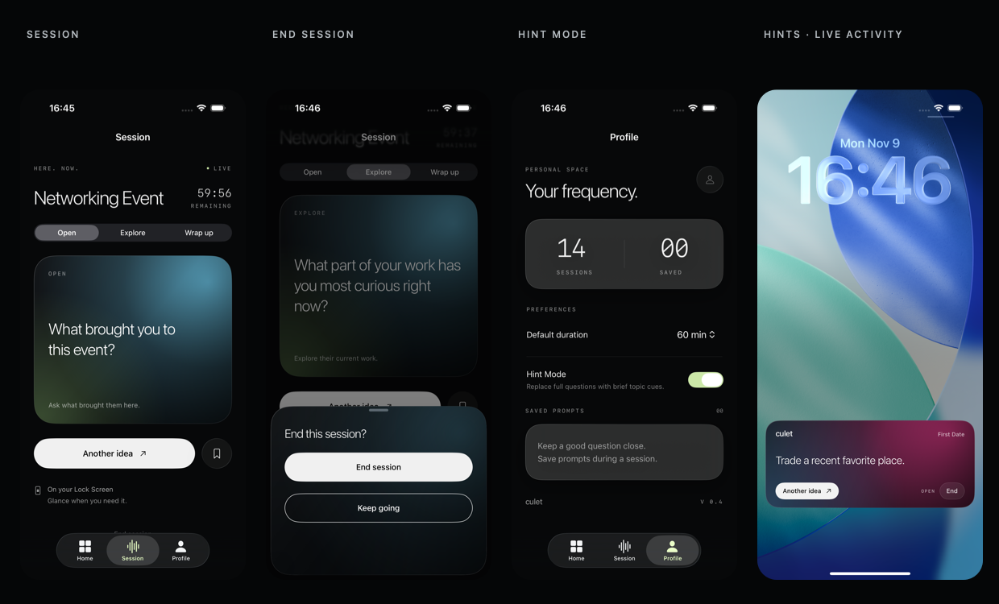

# Culet

A glanceable conversation companion for iPhone. SwiftUI, ActivityKit, WidgetKit, App Intents. **iOS 26+ / Xcode 26+**; verified using Xcode 27.

用 Xcode 打开 **Culet.xcodeproj**，选择 **Culet** scheme。新版本已统一改名，移除白色线条插画，并让 App 和 Live Activity 共用渐变卡片。



## Run on your iPhone

1. Connect and unlock the iPhone; trust the Mac and enable Developer Mode when prompted.
2. Open `Culet.xcodeproj`, choose the **Culet** scheme and your physical iPhone as the run destination.
3. Under **Signing & Capabilities**, choose your own Team and automatic signing for both **Culet** and **CuletActivity**. This copy retains your existing team identifier; signing certificates stay in your Xcode account.
4. Set the app identity in one place: select the blue project → **PROJECT Culet** → **Build Settings** → **All**; search for **CULET_BUNDLE_ID** under User-Defined. This copy already retains your existing registered app ID for both Debug and Release. Keep it to continue using your existing phone installation; edit this shared setting only if you intend to use a different app identity.
5. Leave the target Bundle Identifier expressions as generated. The main app uses `$(CULET_BUNDLE_ID)`, the extension uses `$(CULET_BUNDLE_ID).Activity`, and UI tests use `$(CULET_BUNDLE_ID).UITests`. They inherit the same prefix automatically.
6. Run. If Xcode still shows a previous identifier, use Product → Clean Build Folder.

不要只修改主 App 的 Bundle Identifier。这里已把前缀集中到 `CULET_BUNDLE_ID`，扩展会自动跟随，避免 “embedded binary is not prefixed” 报错。

For a simulator, select an iPhone running iOS 26 or later. No signing team, server, external packages, or API keys are needed for simulator use.

## Interface

- **Home:** fourteen scenes, search, categories, and custom scene names.
- **Preparation:** enter a scene card, preview prompts, choose duration and conversation direction, then start.
- **Session:** refresh prompts, choose Open / Explore / Wrap up, and end.
- **Profile:** default preferences and ended-session count.
- **Live Activity:** a compact gradient prompt card on the Lock Screen, with matching scene color and custom refresh/end buttons; expanded Dynamic Island uses the same card surface inside its system-owned black container.

Scene titles use Title Case noun phrases: Mutual Friends, Networking Event, First Date, Party, Team Lunch, Family Gathering, Interest Meetup, Friend Reunion, Wedding, Campus Welcome, Neighborhood Chat, Travel, Conference Break, and Partner’s Family. **Mutual Friends** means meeting new people through friends you already know.

All cards use native radial and linear gradients from `Culet/Shared/CuletCardSurface.swift`. There are no decorative line illustrations, rings, tick marks, or capsule glyphs. The same source is compiled into both app and extension; the selected scene color is included in the activity attributes and restored with the session.

## Hint Mode

Off: show the complete question. On: replace it with a brief topic cue, such as “Ask what brought them here.” Profile provides a simple toggle and short explanation; the preparation card previews the actual selected scene. The scene name remains visible. This is a display preference, not a privacy or security lock. A change applies to the next session; it does not rewrite an already-running activity.

## Activity behavior

Manual refresh uses `LiveActivityIntent`. Lock Screen interaction may require authentication. The card fits within 156 points at standard text sizes. Very long prompts can be shortened visually to fit, while opening the app shows the full prompt. StandBy uses the system background treatment; the Dynamic Island’s outer black background belongs to iOS.

The requested end time is a `staleDate`, not an exact background end schedule. Expired sessions are ended when the app runs or returns to the foreground, or when the user ends them. If Live Activities are disabled or unavailable, the app explains that and continues as an in-app session.

Each of the fourteen built-in scenes has 24 distinct prompts: 8 Open, 8 Explore, and 8 Wrap up, with a short topic-specific cue for each prompt. There are 336 distinct built-in prompts and 24 additional general prompts for custom scenes. A direction does not repeat until all eight prompts have been shown. Switching direction, using the system refresh button, or relaunching preserves progress. Once a direction is exhausted, only that direction begins a new cycle. There is no AI generation, recording, or automatic background prompt rotation in this version.

This copy uses the existing Culet device-signing identity from your previous project. If updating an existing installation, retain your previously registered app bundle ID as `CULET_BUNDLE_ID` and the same team. Legacy preference keys are migrated when the bundle ID stays the same; a different bundle ID is a separate installation. End an old running activity before installing an updated build.

## Code map

| Folder | Responsibility |
|---|---|
| `Culet/App` | App entry, tabs, scene lifecycle, deep links |
| `Culet/Views` | Home, preparation, Session, Profile |
| `Culet/Design` | Theme, panels, prompt cards |
| `Culet/Models` | Scenes, the topic-specific prompt catalog, and persistent non-repeating progress |
| `Culet/Services` | Session persistence and activity lifecycle |
| `Culet/Shared` | Shared gradient surface, compact activity card, attributes, interactive intents |
| `CuletActivity` | Lock Screen and Dynamic Island configuration |
| `CuletUITests` | Conversation journey and system activity presentation checks |

## Checks

Run Product → Test on a fresh simulator installation. The system-presentation test pulls down Notification Center to inspect the live Lock Screen presentation and refresh it. It does not validate physical-device authentication or Always-On behavior.

Prompt-library checks:

```sh
mkdir -p /tmp/culet-module-cache
swiftc -module-cache-path /tmp/culet-module-cache Culet/Models/Conversation.swift Culet/Models/PromptCatalog.swift Culet/Models/PromptProgress.swift Checks/PromptChecks.swift -o /tmp/culet-prompt-checks
/tmp/culet-prompt-checks
```

Still deferred: scheduled starts, APNs rotation, AI personalization, accounts, sync, a final app icon, and distribution packaging.

## Interaction and content update

End session opens a small custom gradient bottom sheet with a filled **End session** button and a white outlined **Keep going** button. Canceling leaves both the session and the Live Activity running. Confirming ends the activity and clears the session. This replaces the system action-sheet confirmation.

Session no longer tells people to unlock their phone. The app does not change iOS authentication rules for system activity buttons. Profile contains preferences and the ended-session count; the account/storage disclaimer and conversation philosophy copy have been removed.

The expanded prompt library is compiled locally into **both** app and widget extension. Activity attributes contain the scene ID and session metadata; content state contains an index, direction, and small visited-index history. Full prompt libraries are never serialized into activity attributes or updates. End a running activity before upgrading to this payload version. Local preferences are retained.

The previously proposed empty Session redesign was not adopted. The delivered empty state is retained in this update.
